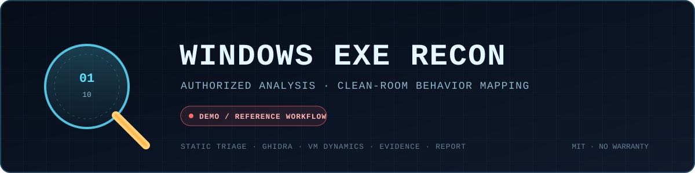

# Windows EXE Recon



> [!WARNING]
> **Demo / reference workflow.** This repository is a demonstration, not a
> certified malware-analysis or forensic product. Use it only on software you
> own or are authorized to test, execute unknown binaries only in an isolated
> VM, and do not use it to bypass protections. It is provided **as is**, with
> no warranty and with the liability limits in [`DISCLAIMER.md`](DISCLAIMER.md).
> See also [`SECURITY.md`](SECURITY.md).

**Status:** demo / reference workflow · **License:** MIT · **No warranty**

A portable [OpenCode](https://opencode.ai) skill for authorized, defensive
analysis of Windows executables. It helps an agent triage a PE file, map its
behavior, record evidence, and plan an independent reimplementation without
copying code, assets, or branding.

The skill is target-agnostic. It contains no sample-specific paths, product
names, or reverse-engineering results.


```
        .-----.
       /  .-.  \      WINDOWS EXE RECON
      |  ( 0 )  |     authorized analysis · clean-room behavior mapping
       \  '-'  /      DEMO / REFERENCE WORKFLOW
        '-----'
          |
          '--->  static triage · Ghidra · VM dynamics · evidence · report

  MIT · NO WARRANTY · USE ONLY ON AUTHORIZED SOFTWARE
```


## Characteristics

- **Target-agnostic** — works with any Windows PE file, not a specific product.
- **Defensive by default** — static triage first; execution only in an isolated
  VM and only with permission.
- **Clean-room oriented** — documents behavior and interfaces without copying
  code, assets, icons, logos, or branding.
- **Evidence-driven** — hashes, timestamps, commands, and confidence levels are
  recorded so another analyst can reproduce the result.
- **Phased** — intake, static triage, deep analysis, dynamic observation,
  behavior map, report, and independent implementation plan.
- **Tool-agnostic** — uses what is already available; optional tools are listed
  explicitly and are never installed automatically.
- **OpenCode-native** — follows the V2 skill format with `SKILL.md`, references,
  scripts, and templates.
- **No bundled binaries** — the repository contains instructions and scripts,
  not target samples or third-party code.

## Requirements

| Requirement | Required | Notes |
|---|---:|---|
| OpenCode V2 | Yes | Loads the skill and runs the agent workflow. |
| Windows 10/11 | Yes for the scripts | The workflow is PE-centric. |
| PowerShell 5.1+ or 7+ | Yes | Scripts are tested with Windows PowerShell 5.1. |
| Authorization | Yes | Analyze only owned or explicitly authorized software. |
| Isolated VM for execution | Yes | Snapshot first; no real credentials. |
| Git | Recommended | Clone and update the skill. |
| Ghidra, Sysinternals, Wireshark, 7-Zip | Optional | Deeper static, dynamic, network, and archive work. |

Full details: `references/requirements-and-tooling.md`.

The PowerShell scripts are read-only with respect to the target; they never
execute it.

## Applications and upstream projects

The skill does not bundle or install these applications. They are optional
upstream tools referenced by the workflow:

| Project | Used for |
|---|---|
| [OpenCode](https://opencode.ai) | Agent host and skill format |
| [PowerShell](https://github.com/PowerShell/PowerShell) | Orchestration and PE triage |
| [Ghidra](https://github.com/NationalSecurityAgency/ghidra) | Static analysis and decompilation |
| [Sysinternals](https://learn.microsoft.com/sysinternals/) | Procmon, Process Explorer, Sigcheck, Autoruns, TCPView |
| [Wireshark](https://www.wireshark.org/) | Network capture and protocol inspection |
| [7-Zip](https://www.7-zip.org/) | Installer and archive inspection |
| [x64dbg](https://github.com/x64dbg/x64dbg) | Authorized debugging |
| [WinDbg](https://learn.microsoft.com/windows-hardware/drivers/debugger/) | Kernel and user-mode debugging |
| [pefile](https://github.com/erocarrera/pefile) | PE parsing in Python |
| [Capstone](https://github.com/capstone-engine/capstone) | Disassembly in Python |
| [YARA](https://github.com/VirusTotal/yara) | Rule-based scanning |

The complete list, including Detect It Easy, HxD, and official repository
links, is in `references/requirements-and-tooling.md`.

## Safety first

- Analyze only software you own or are authorized to test.
- Treat unknown binaries as potentially malicious.
- Execute unknown binaries only inside an isolated VM or sandbox.
- Do not bypass DRM, licensing, authentication, activation, or anti-cheat.
- Do not copy code, decompiled code, assets, icons, logos, or text.
- Ask before installing tools, enabling network access, or publishing results.

See `SKILL.md` and `references/safety-and-scope.md`.

## Security and responsibility

This project is a **demo/reference workflow**, not a certified security
product. It may miss behavior, produce incomplete evidence, or return false
positives. You are responsible for:

- having authorization for the target;
- isolating unknown binaries in a disposable VM;
- protecting personal, customer, and confidential data;
- complying with licenses, contracts, and applicable law;
- reviewing any script before running it.

The authors and contributors accept no liability for misuse, damage, data loss,
or legal consequences. Read the full [`DISCLAIMER.md`](DISCLAIMER.md) and the
[`SECURITY.md`](SECURITY.md) policy before use.

## Install

### One command (recommended)

PowerShell:

```powershell
irm https://raw.githubusercontent.com/Diero15/windows-exe-recon/main/install.ps1 | iex
```

CMD:

```bat
powershell -NoProfile -ExecutionPolicy Bypass -Command "irm https://raw.githubusercontent.com/Diero15/windows-exe-recon/main/install.ps1 | iex"
```

This installs globally to:

```text
%USERPROFILE%\.config\opencode\skills\windows-exe-recon
```

### Download the ZIP

1. Open <https://github.com/Diero15/windows-exe-recon/archive/refs/heads/main.zip>.
2. Extract it.
3. Double-click `install.cmd`.

The ZIP also contains `install.ps1` if you prefer PowerShell. For a versioned
snapshot, use the tagged archive:

```text
https://github.com/Diero15/windows-exe-recon/archive/refs/tags/v1.0.1.zip
```

### From a clone

```powershell
git clone https://github.com/Diero15/windows-exe-recon.git
cd windows-exe-recon
.\install.cmd
```

Or:

```powershell
.\install.ps1
```

The installer:

- copies `SKILL.md`, `references`, `scripts`, and `templates` to the skill
  folder;
- does not require administrator rights;
- does not install analysis tools;
- does not execute the target binary.

### Project-local

```powershell
cd C:\path\to\project
C:\path\to\windows-exe-recon\install.ps1 -Project
```

This installs to `<project>\.opencode\skills\windows-exe-recon`.

### Custom destination

```powershell
.\install.ps1 -TargetDir C:\path\to\skills\windows-exe-recon
```

Use `-Force` to update an existing installation:

```powershell
git pull
.\install.ps1 -Force
```

### Uninstall

```powershell
.\install.ps1 -Uninstall
```

Project-local:

```powershell
cd C:\path\to\project
C:\path\to\windows-exe-recon\install.ps1 -Project -Uninstall
```

Custom destination:

```powershell
.\install.ps1 -TargetDir C:\path\to\skills\windows-exe-recon -Uninstall
```

### Load the skill

Mention it explicitly:

```text
Use @windows-exe-recon to analyze C:\Samples\app.exe.
Do not execute it on the host. Start with static triage.
```

OpenCode can also advertise the skill automatically from its description. If it
does not appear immediately, run `/reload`.

Verify the global installation:

```powershell
Test-Path "$env:USERPROFILE\.config\opencode\skills\windows-exe-recon\SKILL.md"
```

### Manual installation

If you prefer to copy files manually, place this directory at:

```text
Windows: %USERPROFILE%\.config\opencode\skills\windows-exe-recon
macOS/Linux: ~/.config/opencode/skills/windows-exe-recon
```

The resulting layout must contain `SKILL.md`:

```text
~/.config/opencode/skills/windows-exe-recon/
├── SKILL.md
├── references/
├── scripts/
└── templates/
```

## What is included

```text
SKILL.md                         workflow and safety contract
DISCLAIMER.md                    demo status, warranty, and liability
assets/banner.svg                README banner
assets/banner.txt                ASCII banner
install.ps1                      one-command installer
install.cmd                      Windows launcher for the installer
package.ps1                      build the release ZIP locally
VERSION                          current skill version
CHANGELOG.md                     release history
RELEASE_NOTES.md                 notes used by the GitHub release
RELEASING.md                     release workflow and manual steps
ci/release.yml                   GitHub Actions release template
references/
  safety-and-scope.md            authorization, isolation, malware handling
  static-triage.md               PE, imports, strings, signatures, packers
  ghidra.md                      Ghidra UI and headless workflow
  dynamic-analysis.md            VM, Procmon, network, before/after snapshots
  reporting.md                   report structure and confidence levels
  requirements-and-tooling.md    requirements, applications, upstream repos
templates/
  report.md                      fill-in report template
scripts/
  New-AnalysisWorkspace.ps1      create evidence folders and record hashes
  Get-ExeTriage.ps1              static PE inventory as JSON or text
  Get-StringSignals.ps1          extract interesting ASCII/UTF-16 strings
  Invoke-GhidraHeadless.ps1      wrapper for analyzeHeadless
```

## Quick start

```powershell
# Create an evidence workspace and record the target hash.
.\scripts\New-AnalysisWorkspace.ps1 -Target C:\Samples\app.exe -Out .\analysis-app

# Static inventory.
.\scripts\Get-ExeTriage.ps1 -Path C:\Samples\app.exe -OutFile .\analysis-app\01-static\triage.json

# Interesting strings.
.\scripts\Get-StringSignals.ps1 -Path C:\Samples\app.exe -OutDir .\analysis-app\01-static

# Optional: Ghidra headless import and analysis.
.\scripts\Invoke-GhidraHeadless.ps1 `
  -Target C:\Samples\app.exe `
  -ProjectDir .\analysis-app\03-ghidra `
  -ProjectName app-recon
```

## Releases

The automated release workflow is provided as a template at `ci/release.yml`.
It becomes active when copied to `.github/workflows/release.yml`. See
`RELEASING.md` for the web-UI and token options.

Build the release ZIP locally at any time:

```powershell
.\package.ps1
```

The ZIP contains `install.cmd` and `install.ps1`, so the downloaded package can
be installed without cloning the repository.

## License

MIT. See `LICENSE`.

## Contributing

Keep the skill generic. Do not commit target binaries, customer data, secrets,
or product-specific analysis. Add new techniques as reusable guidance, not as
findings about a single executable.
